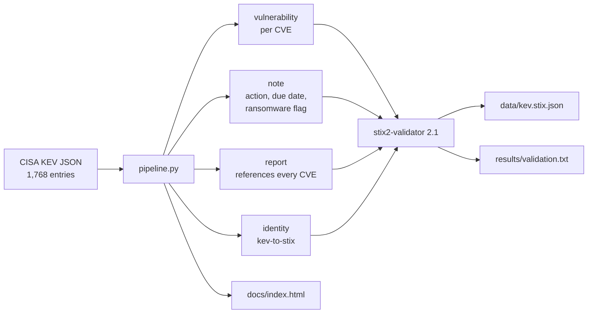

# kev-to-stix

Daily conversion of the **CISA Known Exploited Vulnerabilities** catalog into a validated
**STIX 2.1** bundle, with a static dashboard. The mapping is fixed and tested; the validator's
real output is committed next to the bundle.

**Dashboard:** https://youssefbouaouina.github.io/kev-to-stix/

## Why

Threat-intel feeds are only useful when they arrive in a shape a platform can ingest. KEV is one
of the few feeds with a clear licence (US public domain) and a clear meaning: these are
vulnerabilities that are *known to be exploited*. This project shows the full path — fetch,
normalise, model in STIX, validate, publish — and keeps the evidence.

## Snapshot (local run, catalog 2026.11.04)

| Metric | Value |
|---|---|
| KEV entries | **1,768** |
| STIX objects | **3,538** |
| `vulnerability` objects | 1,768 |
| `note` objects | 1,768 |
| `report` objects | 1 |
| `identity` objects | 1 |
| Known ransomware campaign use | 361 |
| Forensic triage required | 97 |
| Validation | `[+] STIX JSON: Valid` (exit 0) |

Top vendors by entry count: Microsoft 390, Cisco 102, Apple 96, Adobe 83, Google 76.
The full breakdown is in [`data/summary.json`](data/summary.json) and on the dashboard.

The exact validator output is in [`results/validation.txt`](results/validation.txt); the bundle
is [`data/kev.stix.json`](data/kev.stix.json). Both are generated by `pipeline.py`, never edited.

## Mapping contract



- One `vulnerability` per KEV entry, named after the CVE, with an `external_references`
  entry (`source_name: cve`) and an NVD URL.
- One `note` per entry containing the required action, due date, ransomware flag, forensic
  triage flag, CWEs and the feed's notes. The note references its vulnerability.
- One `report` per run referencing every vulnerability.
- The pipeline refuses a catalog whose declared `count` does not match its entries.

IDs are **UUIDv5 derived from the CVE**, so re-running over the same catalog yields the same
IDs. The validator emits `{103} not a valid UUIDv4 ID` warnings for that reason; it still exits
0 and reports `Valid`. Determinism was chosen over warning-free IDs so that diffs are reviewable.
This is a deliberate trade-off, not an unnoticed warning.

## Run

```bash
python -m venv .venv && . .venv/bin/activate
pip install -r requirements.txt
python pipeline.py          # fetches the live feed, writes data/, docs/, results/

ruff check . && pytest -q
```

The CI workflow (`.github/workflows/pipeline.yml`) runs the same pipeline daily at 05:15 UTC,
on every push and on demand, uploads the bundle as an artifact, and deploys `docs/` to Pages.

## Limitations

- KEV is a prioritisation list, not a full intelligence feed: it has no CVSS, EPSS, IOCs or
  actor attribution. This project does not invent those fields.
- It maps what KEV publishes. When CISA changes its schema, the pipeline fails loudly (the
  count check and the validator), rather than emitting a silently partial bundle.
- The report references vulnerabilities only; notes are linked from their vulnerability but not
  listed in the report. This keeps the report readable.
- The committed snapshot is one point in time (catalog 2026.11.04). The daily workflow produces
  a fresh bundle; it does not commit it back to `main`.

## Sources and licence

See [`SOURCES.md`](SOURCES.md). Code: MIT.

## Author

**Youssef Bouaouina** — [github.com/youssefbouaouina](https://github.com/youssefbouaouina) ·
[portfolio](https://youssefbouaouina.github.io/)
